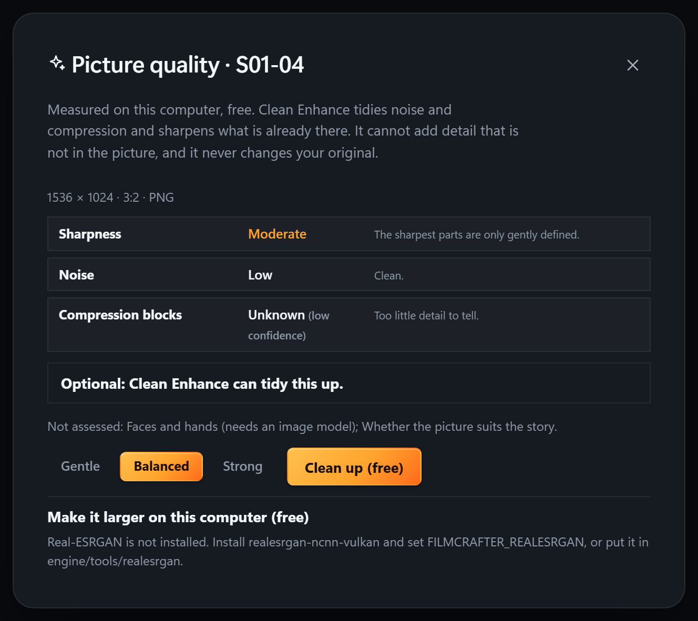

# Picture fidelity (Phase 1)

A free, local quality check for a shot's keyframe, and a careful clean-up that never touches the original. Engine: `analysis/filmcrafter_engine/fidelity.py`. Screen: `src/FidelitySheet.tsx`. Native command: `fidelity` in `src-tauri/src/lib.rs`.

It uses only numpy and Pillow. Nothing is sent anywhere, nothing is billed, and it has no provider or spend path. The follow-on stages (a local super-resolution model, video restoration, finishing and export profiles) are not built; see "Not in Phase 1".

## Where it appears

- **Keyframe → Check quality…** opens the sheet for that shot.
- **Before rendering video**, the price sheet runs the same check on up to 12 keyframes and, if any is below par, adds one line with a link to the sheet. It never blocks the render and changes no price.

## What it measures

Every row is a measurement of the picture, with a confidence (high, medium or low) shown when it is not high.

| Row | How |
|---|---|
| Sharpness | Per 64-pixel tile, how much edge strength survives a re-blur. The sharpest tiles decide the level, so a soft background around a crisp subject reads as depth of field (noted, not blamed). A picture with no crisp tile is "Soft". |
| Noise | Immerkaer's estimator on the flat 40% of the picture. Low confidence when little of the picture is flat. |
| Compression blocks | Step size across 8-pixel borders against the step 4 pixels away (same parity, so a picture enlarged 2× or 4× does not look like a grid). "Unknown" on a reduced, tiny, smooth or flat picture. |
| Clipped highlights/shadows, exposure, contrast, fine texture | Plain measurements. Clipping says it may be intended. |

**Not assessed:** faces and hands (that needs an image model), and whether the picture suits the story. The report says so.

Pictures over 2048 px are measured on a reduced copy, and the report says that.

## Clean Enhance

Edge-aware noise and colour-noise smoothing, JPEG seam softening, sharpening held inside the local range (so it cannot make halos), and a little midtone contrast. The strength is Gentle, Balanced or Strong. It does not add detail that is not in the picture. The cleaned copy is a PNG in `<project>/fidelity/`, with the ICC profile kept and any alpha untouched.

- The original is never written. The engine checks its SHA-256 before and after.
- **Use the cleaned picture** points the shot's keyframe at the copy (only if the keyframe has not changed since); **Go back to the original** restores it. Both are recorded in `fidelity.json`.
- The sheet shows the real original and cleaned files in a split slider, each at 100%, and the measurements before and after.

## What the tests show, and the limits

On synthetic ladders (`analysis/tests/test_fidelity.py`): sharpness falls with blur, noise and block measures rise with grain and JPEG strength, a sharp subject over a blurred background is flagged as depth of field, and plain or smooth pictures say "Unknown" rather than guessing. Against a clean reference, Clean Enhance at Balanced raised PSNR by about 1.7 dB on added grain, left blur about level (sharpening cannot recover lost detail), and removed the block pattern from heavy JPEG with PSNR roughly unchanged.

Known limits:

- The sharpness thresholds were tuned on synthetic images and checked on a few screenshots and one illustration, not on a library of real keyframes. Treat the level words as a guide and tell us when one is wrong.
- A single score is not proof of a better picture. Look at the comparison for halos or changed faces.
- On very noisy pictures the noise estimate can under-read.
- Blur cannot be undone by this stage. For a soft or small picture use the existing **Upscale…** (paid, through Kie.ai or fal.ai).

## Local upscaling (Phase 2, optional)

The sheet can make a 2x/3x/4x copy with a Real-ESRGAN program running on this computer. Free, nothing is sent anywhere.

- **You install the tool; nothing is downloaded for you.** Get `realesrgan-ncnn-vulkan` from the Real-ESRGAN project's releases, then either set the `FILMCRAFTER_REALESRGAN` environment variable to the program or put the folder at `engine/tools/realesrgan`. Its `models` folder must sit next to it. Until then the sheet says how to install it and shows no buttons.
- It runs in 200-pixel tiles so it fits a 12 GB card, with a 30-minute limit, no shell, and the model name checked against what is installed. The output is limited to 8192 px on a side.
- The result goes through the same compare slider, "Use it" and "Go back to the original" as Clean Enhance. The original file is never written.
- A model **invents plausible detail**. The sheet says so; check faces, hands and text.
- **Tested with a stand-in program only.** The tests check our arguments, tiling, safety, files and ledger. The real Real-ESRGAN program was not run here (no model or GPU), so a first run on your machine is the real test. Models for drawings (`realesr-animevideov3`) are chosen when you tick "Drawing or animation".

## Animation master

A cleaned or enlarged picture can be made the shot's **animation master** (button on the sheet: "Use as the animation master"). The keyframe stays what you approved and what the storyboard shows; `render.approved_keyframe` gives the video model the master instead while the keyframe is unchanged. If the keyframe is replaced later the master is ignored (it was made from the old one), and a master file outside the project is never used. "Stop using it as the master" removes it. Stored in `masters.json`.

Limit: the video model still decides what to do with the picture. A sharper master helps it start from more detail; it does not guarantee a sharper video.

## Video finishing (see docs/VIDEO_FINISHING.md)

Flicker measurement, a calmer copy, finishing looks and delivery profiles are in the Export sheet under "Finish and deliver".
