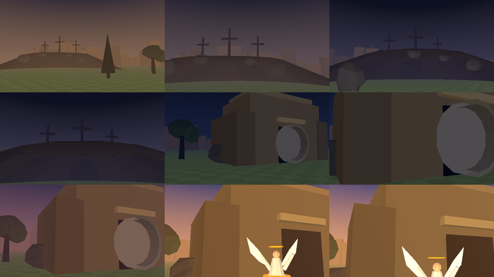
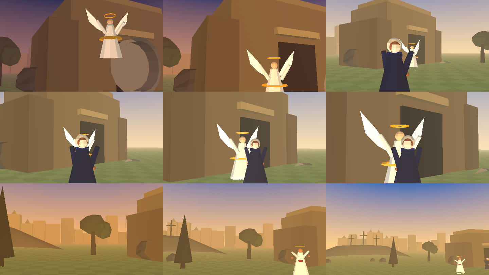
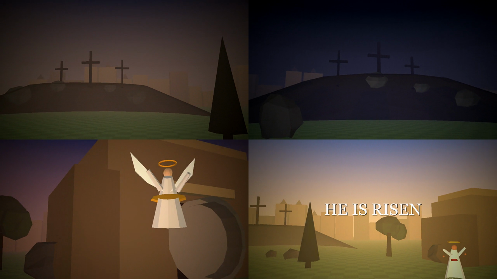
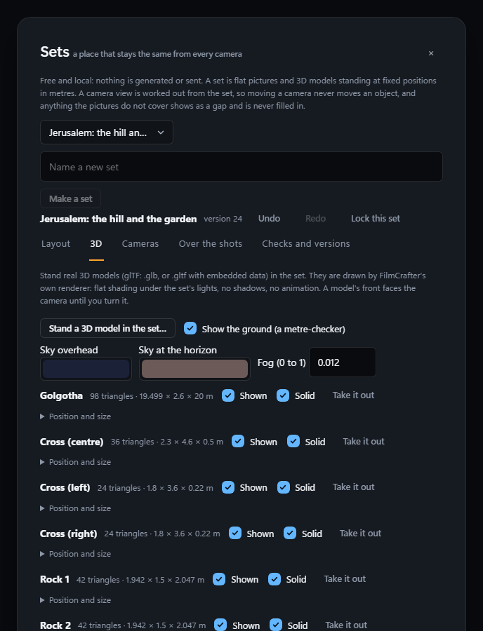
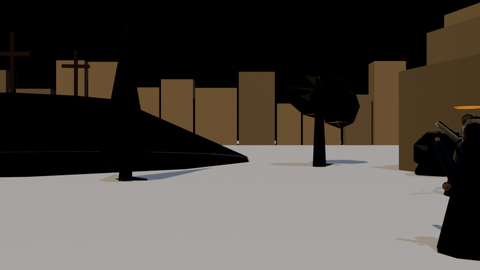

# Virtual production: plan, status and the cutout studio

The brief has three systems: **Virtual Production Studio** (green screen, transparent assets, matting, compositing), **WorldLock** (a persistent spatial scene) and **DirectorCam** (planned cameras and blocking). They are built in thin, tested slices. This page says what is done, what is not, and what each choice rests on.

## Audit of the repository (what was found, 0.47.0)

- Shell: Tauri 2 (Rust `src-tauri/src/lib.rs`, one command per engine area with a fixed action list the security test checks); screens in React and TypeScript; engine in Python (`analysis/filmcrafter_engine`), one JSON line per result. The film folder is the source of truth; records are written with `safeio`.
- Engine packages in the product: **numpy, Pillow, ffmpeg (through imageio-ffmpeg), soundfile**. **Not present:** OpenCV, SciPy, scikit-image, PyTorch, ONNX Runtime, any segmentation or matting model, any 3D library, Blender. A new heavy dependency is never added silently; optional adapters for them are installed on purpose, with size and licence shown.
- Existing, reused or left alone: layers, overlays, blend modes, a simple colour key and masks in `composite.py` (per layer, applied at export), colour studio, lighting, colour match, continuity checks, Production Bible (characters, places), shot list with camera fields, ledger and paid-operation gate. None of it knew about alpha cutouts, a persistent set, or a camera in space.
- The Cinematic Fidelity Engine named in the brief is not a module in this repository (there is a fidelity sheet and quality checks); integration with it is a later slice and will say what it actually connects to.
- No Pulseframe or Greenroom code is touched. The picture algorithms are in `keying.py`, which has no film, file-of-the-film or network dependency, so Pulseframe can reuse it as it stands (copy the file; extraction into a shared package is not attempted yet).

## Slices

| Slice | Contents | State |
|---|---|---|
| 1 (0.47.0) | Cutout studio: plate check, chroma key with despill and decontamination, edge refine, RGBA PNG and mask export, stills compositing with transform, contact shadow, colour match; plate prompt (words only) | **Done, tested on synthetic plates with known answers; not yet tried on a real photograph** |
| 2 (0.48.0) | Production Mode on shots (Full scene, Green screen, Transparent); video: clip keying with temporal smoothing, PNG sequences and alpha video (ProRes 4444, VP9), keyframed compositions over a still or a clip, MP4 render with cancel | **Done, tested on real encoded video made for the tests; not yet tried on camera footage.** Layered scene is not built and is shown greyed |
| 3 (0.49.0) | WorldLock package (versioned set, stable ids, undo/redo, lock, saved versions) and 2.5D set builder (flat layers at fixed world positions, parallax, saved cameras, gap warnings, events over the shots, basic continuity checks) | **Done, tested on real rendered views; layers are flat and nothing is inferred** |
| 4 | Continuity inspector on the set (object and prop state over shots, screen direction) | Partly done in slice 3 (the line-crossing check, orphan events, bounds, missing pictures); a fuller inspector is not started |
| 5 | True 3D set (glTF import, hierarchy, lights, cameras, render of several views); Blender as an optional backend | Not started |
| 6 (0.50.0) | DirectorCam: shot plan from a story beat on a set (plain word rules, no model), cameras placed by shot size with a real filmback, eleven camera moves as deterministic paths, advice with deliberate overrides, shot packages (first and last frame, path strip, depth map, object map, motion in words), provider support per input | **Done, tested on real renders; the planner reads words and does not understand stories** |
| 7 | AI-assisted reconstruction from reference images (inventory, draft layout, optional image-to-3D adapters), approval and set locking | Not started |
| 8 | Fidelity integration, performance, recovery and export validation | Not started |

Nothing in slices 2 to 8 exists yet: no placeholder screens were added for them.

## Slice 1: the cutout studio

Rail > More > **Cutouts** (any screen of a film; it opens in the timeline Studio). Three steps in one dialog.

1. **Pictures.** Bring in a *plate* (a subject in front of a green or blue screen), a *background* or a *foreground*. The file is copied into `vp/sources/`; the original is never touched; the same picture twice is kept once. **Words for a clean plate** writes the text to ask an image or video maker for an evenly lit screen with no green on the subject. It sends nothing.
2. **Cut out.** **Check the screen** reads the border of the plate for the screen colour and how even it is, and says in numbers whether a key is likely to work. **Cut out** keys the plate. Settings: screen colour, similarity (how far from the screen colour still counts as screen), edge softness (0 = worked out from the picture), shrink and grow the edge, feather, remove screen colour from the subject, fill holes, clean the colour of the edge. Each cutout keeps the settings that made it and what the key found, as a straight-alpha RGBA PNG (`vp/cutouts/<id>/cutout.png`) and its mask. **Export PNG** copies it to `exports/virtual-production/` and reads the file back to confirm it really has transparent pixels.
3. **Compose.** Pick a background (or a plain colour) and a size, add cutouts bottom to top, each with its place (the *feet* are what is placed, not the edge of the picture), size, turn, flip, contact shadow and colour match. **Save and render** writes a PNG under `vp/renders/`.

### How it works, and what it does not do

- The key measures each pixel's colour distance from the screen colour in the chroma plane (Cb, Cr, BT.709) only, so a darker or lighter patch of the same screen still counts as screen. Between "screen" and "subject" the transparency is a straight ramp whose end is taken from the plate (the weaker-coloured fifth of the subject decides), which is what keeps hair and soft edges.
- Along the edge a pixel is a mix of subject and screen. The screen's share is removed from the colour in linear light (decontamination), then the screen's channel is limited (despill), so no green or blue fringe is left.
- Compositing is in linear light with premultiplied alpha, so edges get no dark or light halo. A contact shadow is the subject's feet outline, flattened and blurred: it grounds the subject; it is not a render of the real light. Colour match pulls the subject half way toward the picture's mean and spread; it is a pull, not a relight.
- It **does not know what a person is.** There is no segmentation or matting model, so it cannot cut a subject out of a picture with no screen, it cannot track a subject through video, and green that is on the subject (a green jacket on a green screen) is keyed out with the screen. A plate whose screen is uneven or noisy gives a poor key; `Check the screen` is there to say so before time is spent. Models for those cases (a segmentation model, a video matting model) would be optional adapters installed on purpose; none is included or downloaded.
- Hair is kept as far as the plate allows: very fine strands against a noisy screen can be lost, and no hair-specific refinement exists beyond the soft ramp and decontamination.
- Transparent H.264 MP4 does not exist and is not offered. Stills only so far: no video, no PNG sequences, no keyframes.

## Slice 2: clips, alpha video, keyframes and the shot's production mode (0.48.0)

**Production mode (Shots > Camera).** Each shot has *How this shot is made*: **Full scene** (as before; saying so changes nothing), **Green screen** or **Transparent**. A green screen or transparent shot is asked for as a *plate*: the picture prompt gets a sentence asking for the subject on a flat, evenly lit green or blue screen (framing, light direction, angle and what the subject does are chosen on the shot), and the place is left out of the prompt because the background is put in later. **Transparent** is made the same way and keyed afterwards: none of the picture or video models in the product make transparency themselves, and nothing here pretends they do. **Layered scene** (separating a shot into background, characters and effects) is not built; the option is shown greyed.

**Clips (Cutouts > 1 Pictures and clips, 2 Cut out).** Bring in a clip (MP4, MOV, WebM, MKV, AVI, M4V; up to 30 seconds, 4096 px a side, 500 MB). Keying a clip cuts it into frames (at most 30 a second, 720 frames), works out the screen colour and the edge ramp *once* from five frames (so every frame is keyed the same way and the edge does not breathe), keys each frame, and optionally **calms the edge between frames**: each frame's transparency is blended with its two neighbours, less where the edge is moving. The report gives the *flicker* (how far a frame's transparency is from the average of its neighbours, where the neighbours agree) before and after. Progress is shown and **Stop** ends the job at the next frame, removing only that run's unfinished output.

**Alpha export.** A PNG sequence (straight alpha, numbered from 1), **ProRes 4444** (.mov) or **VP9 with alpha** (.webm), each only if this app's own ffmpeg can encode it (asked, not assumed; the button is greyed with the reason otherwise). Every file is read back: a frame is decoded and its transparency compared with the mask, and the screen says plainly if none was found. Transparent H.264 MP4 does not exist and is never offered.

**Composition in motion (3 Compose).** A layer is a still or a clip cutout with a *start time*, *repeat* (clips), and **keyframes**: at a time, any of across, down, size, turn and opacity, each moving straight, eased or jumping to the next. The background can be a still or a clip. **Save and render a picture** draws the frame at the second you give; **Save and render a video** writes an H.264 MP4 (yuv420p, BT.709 tagged) at 1 to 30 frames a second, at most 720 frames, with progress and Stop. A cancelled render leaves no half-made file.

### Limits of slice 2

- Still no segmentation or matting model, no tracking, no motion blur; a clip without a screen cannot be cut out. The temporal smoothing is a plain blend, not a motion-compensated filter: fast sideways motion of the subject's edge is protected only by the "less where it moves" rule.
- Rendering is slow in proportion to size and frames (every frame is composed on the CPU in linear light); 720 frames at 1080p takes minutes. Frames are on disk, so memory is not the limit.
- Depth-aware occlusion, hair-specific refinement and manual mask painting are not built.
- The keyframe screen edits numbers, not a draggable path.

#
## Slice 3: WorldLock, a persistent 2.5D set (0.49.0)

Rail > More > **Sets**. A **set** lives in the film (`worldlock/<id>/`): a world in metres (X right, Y up, Z forward into the set; bounds; an origin), **pictures** (flat layers, props, landmarks) standing at fixed positions with a width and height in metres, **characters** on the floor with a facing, saved **cameras** (position, turn, tilt, field of view), lights and environment words, and **events** that change the set over the shots of the film. The set is the source of truth, not a prompt.

**How a view is made.** Not generated: computed. Each picture is placed by a pinhole projection (`worldmath.py`), far to near, premultiplied so edges have no halo. So the same camera always gives the same picture, and moving a camera never moves an object: objects keep their world coordinates and only their screen positions change, with parallax (near things move further than far things). **What the pictures do not cover is a gap**: it is measured (`uncovered`), warned about in plain words, and shown as the plain base colour. Nothing is hallucinated behind a layer. **Check the move** walks a camera between two saved cameras and reports where a move goes past what the set covers.

**The set over time.** The set as built is never changed by an event. An event says that a picture or a character moves, is left in a state ("on the floor"), leaves or appears, at a shot. A view *as at shot N* replays the events of the shots before N on top of the set. So a basket that falls in shot 12 is where it fell in shot 13 and the set still says where it was put.

**Separating a picture into layers (`cut_layer`).** There is no depth estimation and no inpainting. You cut a region out of a picture into its own layer at another depth; the new layer is scaled and placed so that, from the camera, it covers exactly the same part of the view; the original is left whole (what was behind the region is not known). Moving the camera then separates the cut layer from the backdrop.

**Safety of the work.** Every change goes through one path: a **locked** set refuses changes (it is the approved environment; looking is always allowed), the state before every change is kept for **undo and redo** (50 deep), every change counts a version, and a **saved version** is kept for good and can be restored (restoring is itself undoable). Nothing is deleted: a removed picture moves to `removed` (its file stays), a removed set moves to `worldlock/_removed/`. Pictures are copied in; the originals are never touched. A set file of the wrong shape is refused and left exactly as it is.

**Checks.** Pictures whose file is missing or that stand outside the world; cameras outside the world or inside a picture; events about things no longer in the set or at shots that no longer exist; and, for two characters chosen as the line, a camera that crosses that line between two consecutive shots (the 180-degree rule).

### Limits of slice 3

- **2.5D only.** A picture is flat: no sides, nothing behind it, no 3D mesh. A camera that goes far from where the pictures were made shows their flatness. Moving the camera shows exactly what the pictures cover, no more.
- Lights and environment are stored for the planner and for prompts; they are **not** painted into the views. Characters appear on the plan and are drawn only if given one of the set's pictures.
- No depth estimation, no segmentation, no reconstruction from a reference image, no 3D import, no Blender: those are later slices. No camera is steered by dragging; positions are typed in metres (the plan is clickable to select).
- Generated shots are **not** guaranteed to match the set: the set is the ground truth the shots will be checked against (DirectorCam, later).

#
## Slice 5: true 3D, animation and a Blender bridge (0.51.0)

- **Models:** glTF 2.0 (.glb, or .gltf with embedded buffers) read by `world3d.py`; the node tree is applied; the model is mirrored on import so its front faces the camera at rest. Limits: 60 MB, 150,000 triangles, 4096-pixel textures; skins, animations, extensions and external buffers are ignored or refused and each is listed as a warning.
- **Renderer:** software rasteriser (near-plane clipping, depth buffer, perspective-correct textures, Lambert lighting from the set's lights plus ambient, linear light), exact ground-plane intersection, sky gradient and distance fog. No shadows, reflections or global illumination.
- **Set:** models, groups (parent chains, loops refused), ground, sky; 60 models and 40 groups at most; **collisions** on bounding boxes, **occupancy** grid, **four views**. Everything goes through the one change path (lock check, undo, version count).
- **Animation:** `worldanim.py` tracks for camera, models, lights, sky, ambient; shake; MP4 output; stop by flag file; multi-process.
- **Blender bridge (experimental):** `blenderbridge.py` finds Blender and writes `build_scene.py`; not run in a real Blender.
- **Test film:** `scripts/film/` builds "He Is Risen" (60 s).
- **What it looks like** (real output of the renderer, frames from the test film at 480x270; the second sheet continues the film; the last image is graded final frames with the title):

  
  
  

  The 3D tab (real screenshots from the screenshot harness; scenes `sets3d` and `sets3dviews`):

  
  

  **Blender bridge, tried for real (Blender 5.2.2):** the script ran headless and rendered the set (19 models, camera and placement correct, real shadows). It found a bug (the engine name `BLENDER_EEVEE_NEXT` does not exist in 5.x; now picked from what the installed Blender offers). What it does **not** carry over yet: the set's ground colour, sky and light settings, so the render is washed out (white ground, black sky, strong sun):

  

- **Not built:** AI-assisted reconstruction from reference images (no vision/segmentation model is installed; planned as an honest draft layout needing approval), the fuller continuity inspector (slice 4), Fidelity integration (slice 8).

## The guided way in: a set for a place (0.52.0)

The set builder was a tool under More. The golden path now reaches it from where a film already describes its places: **Cast > Places > (a place) > Set**. Two ways, plainly worded: **From this place's pictures** (2D: the first picture becomes a backdrop 14 m away, the others layers in front, a ground and a camera) and **From a 3D model** (a .glb/.gltf, or a Blender .blend that Blender saves as a .glb in the background, or **Build it in Blender**: a blank .blend with a floor is made and opened, and **Bring it back from Blender** reads it again and swaps the model, keeping where it stood). After that: **Look from the camera**, **Plan the shots** (DirectorCam on this set) and **Edit the set** (the full builder). `placeset.py` keeps the place-to-set link in `worldlock/place_sets.json`; sets are the same sets as before. Tested against a real Blender 5.2.2 (blank file, bring back twice, a .blend of the user's own) and without Blender (the ways are greyed with the reason). Limits: one set per place; a model from Blender is stood 4 m ahead of the camera and may need moving; lights, sky and materials from Blender are not carried over (only geometry and colours the glTF exporter writes); a Blender place's ground is left off so it does not fight the model's own floor.

## Blender look and Blender animation (0.53.0)

`blenderbridge.scene_data` is now the one place the numbers for a Blender scene are worked out (models, cameras, lights, ground colour, sky gradient, ambient level), used by the still script and by `render_animation`, which works out every frame with `worldanim.state_at` (so the animation is identical to the built-in renderer's) and has Blender draw the frames in parallel processes (fixed script, fixed arguments, a time limit of three hours, stop with `cancel.flag`). Checked against real Blender 5.2.2. What does not come across: fog, the checker pattern of the ground (a flat colour), materials beyond what the glTF carries.

## Slice 6: DirectorCam (0.50.0)

Rail > More > **DirectorCam** (needs a set from Sets). The order of the work is the brief's: read the set, find the people and things, propose shots, assign cameras, propose blocking, validate, preview, approve, make a package.

**Cameras.** A camera has a position, turn (yaw) and tilt (pitch), a **filmback** (sensor width, default 36 mm), a **focal length** (the field of view follows it, or the other way round), an aperture, a picture shape (16:9, 2.39:1, 1.85:1, 4:3, 1:1, 9:16) and an optional focus target. A **shot size** is a height of the world that fits in the frame (extreme close-up 0.25 m, close-up 0.5 m, medium close-up 0.8 m, medium 1.2 m, medium wide 1.8 m, wide 2.8 m, establishing 9 m); the camera's distance follows from the lens and that height by trigonometry and it is turned to look at the subject. An *over the shoulder* shot stands behind the first person's shoulder looking at the second, on the side you choose of the line between them. Choosing a size places the camera for you; every number can then be typed.

**Moves.** Static, pan, tilt, dolly, truck, pedestal, crane, orbit, tracking, push in, pull out, each a plain transform sampled into poses (`camera_path`): deterministic, eased or linear, with the units written next to the control (metres or degrees, and which way is positive). Every pose of a move is checked against the set, so a move that goes past what the pictures cover is reported before it is rendered.

**From a story beat.** Type a sentence ("The girl enters the market, sees the oranges, and rushes to help the vendor.") and press **Plan the shots**. Plain word rules over the sentence find the people and things the set has (whole-word matches of their names and tags), read the subject of each clause from who is named before its verb (carried over from the clause before when nobody is), and turn each action word into the shot that usually tells it: an entrance (a wide tracking shot), a look (a close-up that pushes in, then an insert of what is seen), a fall (an insert), a rush or a walk (a medium tracking shot with the person ending 0.9 m from where they are going), a line of dialogue (over-the-shoulder and reverse), a feeling (a close-up). It opens with an establishing shot, gives a reason for every shot, and lists what the beat names that the set does not have. **This is a draft from words**: no model is asked, nothing is saved until you keep it, and it does not understand stories, pronouns beyond "the same person", or anything the set does not name.

**Advice, overruled at will.** Each item names the rule it comes from and says why: the **line** between two chosen people, the **30-degree guideline** (nearly the same view twice in a row), **eyelines** (a person facing more than 70 degrees away from the person they are talking to), **screen direction** (a person crossing the frame one way and then the other), **something in the way** (a tall picture between camera and subject), **subject out of frame**, a camera **outside the set**, **the set not covering the view**, and **a person who jumps** between the end of one shot and the start of the next. A shot can be marked *deliberate* for any rule: the item then becomes a note, not a warning. Warnings, advice and notes are counted.

**Shot packages.** For a chosen shot: the **first frame** and **last frame** rendered from the set (people at their start and end positions), a **strip** of five frames along the camera path, a 16-bit **depth map** (nearer is brighter; each flat picture has one depth), an **object map** (one colour per picture), and `package.json` with the camera, where the camera ends, the people's start and end positions, the props, the lights, the continuity constraints, the motion in words, the character reference pictures and how much of each frame the set does not cover. **What a chosen model can take** is listed input by input as *supported*, *not supported* or *unknown*, with how it is known and a plain alternative: a last frame is offered only where the app's own cached model schemas or its list of models documented to take one say so; reference pictures follow the same name rule the model pickers use; **no model here takes a camera path, a depth map or an object map**, so those say "not supported" and the files are kept for checking and for ComfyUI workflows. Nothing is assumed.

**Into the film.** **Give it to that shot** sets a film shot's framing, angle, lens and movement (mapped to the film's own lists), writes where the camera stands in the set and why, and adds the first frame to the shot's reference pictures. A locked storyboard refuses, as it always does.

### Limits of slice 6

- It plans, previews and packages; it **does not generate** a picture or a video and sends nothing. A generated shot made from a package is **not guaranteed to match the set**: the package is what to check it against (the visual-difference viewer in the brief is not built).
- The planner is English-only word rules. It cannot resolve "she", "the old woman" or any name the set does not use; it says what it could not find instead of guessing.
- Depth and object maps are of flat pictures. There is no true 3D depth, no segmentation of generated images, and no checking of a generated result against the set.
- The plan view is clickable but cameras are not dragged; positions are typed. Camera moves are previewed as first and last frame and a path strip, not as a video.
- Lights are carried into the package as data; they are not painted into previews.

### Tested, and not (slice 6)

Tested on a real film and a real set with measured renders: the camera conventions (forward, right, look-at, vertical field of view); every move's end pose as an exact transform, the orbit keeping its distance and the subject in the middle of the picture at every step, tracking keeping its offset, easing; the frame height of each shot size measured on the rendered projection (within 3%); a longer lens standing further back; over-the-shoulder on the right side; the beat planner on the example beat and on beats it cannot read; plans saved, reopened, approved, removed and flagged when the set has changed; every kind of advice, and a deliberate break becoming a note; first and last frames with the people moved to their start and end places; a package with real depth and object maps; provider support for known, unknown and no model; applying a shot to the film. **Not tested:** a generated video from a package; a real photographic set; planners for stories in other languages; the screens in the installed app.

## Tested, and not (slice 3)

Tested on a real film folder with real pictures: the projection against hand-worked numbers (a point ahead, to the side, above, behind, yawed and pitched); a market set saved and reopened with identical ids and coordinates; where each picture lands in a real rendered view; parallax measured between two real renders (the near cart moves twice as far as the stall at twice the depth); determinism; gaps reported and not filled; a camera move past the set's edge caught; the basket event (before, during and after the shot) with the set unchanged; undo and redo, 50-deep limit, named versions restored, locking, removal that keeps files, damaged files refused; a cut layer that looks identical from the camera and separates when it moves; every kind of check, including the line crossing. **Not tested:** real photographs of a set; a large set with many layers (speed); the screens in the installed app.

## Tested, and not (slice 2)

Tested on a real encoded video: a subject moving across a noisy green screen with a known transparency in every frame, encoded to H.264 with the usual chroma subsampling (so the codec really blurs the edges), then keyed (alpha within 0.02 of the truth on average, more than 93% of the solid subject kept, more than 97% of the screen removed), smoothed (jitter cut to under 60%, subject position within one pixel of the truth), exported (PNG sequence, ProRes 4444 and VP9 decoded back with their transparency within 0.04 of the mask), composed with keyframes over a moving background clip and rendered to MP4 whose size, frame rate and length were read back, with real cancel checks on both jobs. The shot's production mode is tested on the prompt it changes. **Not tested:** camera footage; compression other than the one test clip; very long or very large clips; an editor opening the exported ProRes or WebM files.

## Tested, and not

Tested on synthetic plates made for the tests, whose true transparency and true subject colour are known (a subject with soft hair-like edges and green spill mixed over a noisy, uneven green screen in linear light): the key's transparency against the truth on solid parts, background and soft edges; strands found; brightness changes in the screen not leaking into the subject; green fringe reduced by more than 90%; edge colour recovered much closer to the true colour; the composite over white and over black against the true result, and better than naive compositing; placing, scaling, rotating, flipping; the feet anchor; opacity and layer order; the shadow only at the feet; colour match; RGBA PNG round trip; the whole film flow (import, check, key, export, compose, render) on real files; refusals; nothing deleted; paths that lead outside the film never followed. The screens are tested against mocked answers and against the real engine's answers.

**Not tested:** a real photograph or real generated plate; hair on a real subject; video; how the shadow and colour match look next to real footage; large plates for speed (a 40-megapixel limit protects memory but timing was not measured).
